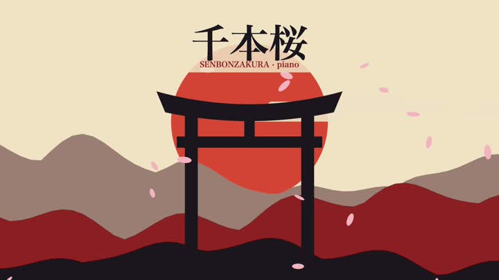

# 千本樱 · 触控板合演

把 MacBook 静音，触控板依然能奏出《千本樱》。这个 macOS 应用用 Force Touch 马达演奏主旋律，同时在内建屏幕上播放一支 4 分 11 秒的原创 MV。画面和触控板共用系统时钟，方便用手机把屏幕和现场声音一起录下来。



## 下载与演奏

1. 在配有 Force Touch 触控板的 MacBook 上，下载并解压 [macOS 应用](https://github.com/jsyzlbw/senbonzakura-trackpad/releases/latest/download/Senbonzakura-Trackpad-macOS.zip)。系统要求为 macOS 14 或更高版本。
2. 双击「千本樱·声画合演」。首次打开时，选择与画面配套的钢琴 MIDI 或已提取的单声部 MIDI。程序会在本机准备并保存曲谱。再次打开即可直接演奏，按住 Option 打开可重新选谱。
3. 听到的是触控板玻璃振动的声音。拍摄时可把电脑放在硬桌面，先让手机开始录像，再打开应用。全屏倒数三秒后开演，按 **Esc** 结束。

发布包自带完整的 1080p 静音 MV 和触控板播放器。它使用本地临时签名，未经 Apple 公证；也可以按下方步骤在自己的 Mac 上从源码构建。实机验证使用 M4 MacBook Air 和 macOS 26.5.2。

### 选择哪份 MIDI

画面按固定 **155 BPM、4/4 拍、4 分 10.684 秒**的钢琴独奏版编排。第一段副歌约在 0:56，最后一次升调约在 3:31。已验证的原谱来自爱给网 MIDI 库，下载文件名为 `千本樱 _爱给网_aigei_com.mid`。原谱单通道包含双手声部，导入后自动提取 1,293 个旋律音符。公开下载包需要使用者自行提供曲谱。[爱给网 MIDI 库](https://www.aigei.com/music/midi)

需要核对版本时，可比较原始钢琴文件的 SHA-256：

```text
3f2150ba8708858f63b756d8d2f4ae117281816a3b56af8c95a30909255236ef
```

## 从源码运行

需要 macOS 和 Xcode Command Line Tools。在仓库根目录运行：

```bash
./scripts/render-mv.sh
./scripts/build.sh
open 'build/千本樱·声画合演.app'
```

第一步使用 Swift、Core Graphics 和 AVFoundation 渲染 7,521 帧，生成 `Assets/Senbonzakura.mp4`。后续只改播放器时，直接运行第二步即可。如果已经下载发布包，也可将应用内的 `Contents/Resources/Senbonzakura.mp4` 复制到 `Assets/`，复用现成视频。

个人构建可将本地曲谱随应用打包：

```bash
./scripts/build.sh --midi '/path/to/千本樱.mid'
```

## 声画如何同步

`Show.swift` 先预加载视频，等触控板进程就绪后，把同一个未来的时刻交给 AVPlayer 和触控板播放器。`PrepareScore.swift` 根据这份钢琴编曲的音区和节奏提取旋律，保留快速连音、休止和末段升调。MV 的每一帧由 `Art/SenbonArt.swift` 按曲中时间绘制。GitHub 下载版的播放和导谱都在本机完成。

## 创作与上游

《千本桜》作词、作曲为黒うさP。MV 画面由 Claude Opus 5.5 创作。触控板合成基于 Cody Collier 的 nospeaker 和 saalse 的 MIDI 播放分支，本项目增加了与视频共用时钟的启动协议。上游代码使用 MIT 许可证。[nospeaker](https://github.com/os6/nospeaker) · [MIDI 播放实现](https://github.com/saalse/nospeaker/blob/3fb85a883d2e51e3ef6205a611681f7ac34fa156/nospeaker.swift) · [上游许可证](LICENSES/nospeaker.txt)
